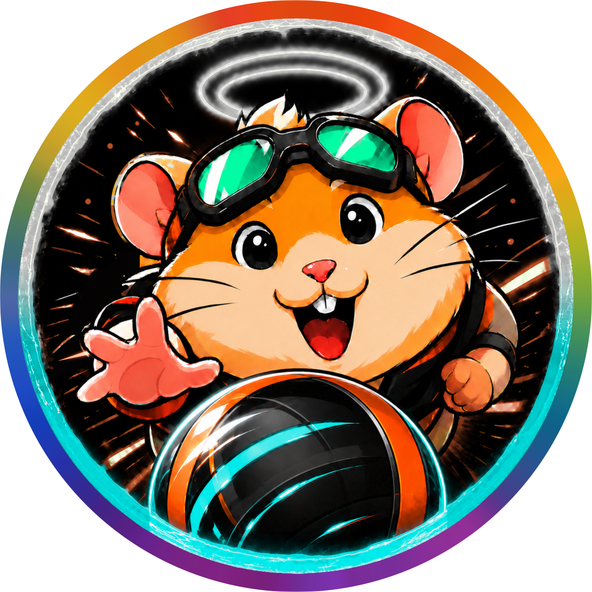
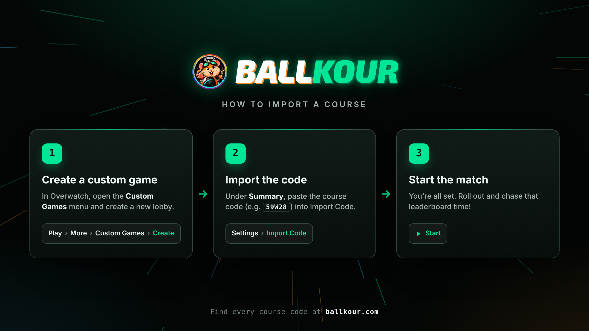

<div align="center">



# Ballkour

_Wrecking Ball parkour courses for Overwatch_

[Website](https://ballkour.com) • [Leaderboards](https://ballkour.com/leaderboards) • [Gameplay](https://ballkour.com/gameplay) • [Discord](https://ballkour.com/discord)

</div>

## Courses



<table>
<tr><th align="right">#</th><th align="left">Course</th><th align="right" colspan="2">Codes</th></tr>
<tr><td colspan="4">Courses by <b>Spiz</b></td></tr>
<tr>
<td align="right">1</td>
<td>🇬🇮 Watchpoint: Gibraltar<br>
<sub>Remaker: ballhallaa</sub></td>
<td align="right"><sub>Latest</sub>

```
59W28
```

</td>
<td align="right"><sub>Beta</sub>

```
9GTJH
```

</td>
</tr>
<tr>
<td align="right">2</td>
<td>🇺🇸 Blizzard World (Winter)<br>
<sub>Remaker: ballhallaa</sub></td>
<td align="right"><sub>Latest</sub>

```
GMWRF
```

</td>
<td align="right"><sub>Beta</sub>

```
8Y14F
```

</td>
</tr>
<tr>
<td align="right">3</td>
<td>🇧🇷 Paraíso<br>
<sub>Remaker: ballhallaa</sub></td>
<td align="right"><sub>Broken</sub><pre><del>NT5G3K</del></pre></td>
<td align="right"><sub>Beta</sub>

```
MXJ0W
```

</td>
</tr>
<tr>
<td align="right">4</td>
<td>🇩🇪 Eichenwalde</td>
<td></td>
<td align="right"><sub>Broken</sub><pre><del>9AVPN</del></pre></td>
</tr>
<tr>
<td align="right">5</td>
<td>🎯 Practice Range</td>
<td></td>
<td align="right"><sub>Code</sub>

```
KSG9E9
```

</td>
</tr>
<tr><td colspan="4">Courses by <b>Fasteroid</b></td></tr>
<tr>
<td align="right">6</td>
<td>🇲🇽 Dorado</td>
<td></td>
<td align="right"><sub>Code</sub>

```
N8ZFR
```

</td>
</tr>
<tr>
<td align="right">7</td>
<td>🇬🇷 Ilios</td>
<td></td>
<td align="right"><sub>Code</sub>

```
4BA40
```

</td>
</tr>
<tr><td colspan="4">Courses by <b>Senimar</b> &nbsp;<sub>easiest → hardest</sub></td></tr>
<tr>
<td align="right">8</td>
<td>🇧🇷 Paraíso</td>
<td></td>
<td align="right"><sub>Broken</sub><pre><del>5P58Q</del></pre></td>
</tr>
<tr>
<td align="right">9</td>
<td>🇪🇬 Temple of Anubis</td>
<td></td>
<td align="right"><sub>Code</sub>

```
18ZZK
```

</td>
</tr>
<tr>
<td align="right">10</td>
<td>🌙 Horizon Lunar Colony</td>
<td></td>
<td align="right"><sub>Code</sub>

```
JEFA9
```

</td>
</tr>
<tr>
<td align="right">11</td>
<td>🇺🇸 Blizzard World</td>
<td></td>
<td align="right"><sub>Code</sub>

```
D6WC7
```

</td>
</tr>
<tr>
<td align="right">12</td>
<td>🇲🇨 Circuit Royal</td>
<td></td>
<td align="right"><sub>Code</sub>

```
71GPZ
```

</td>
</tr>
<tr>
<td align="right">13</td>
<td>🇯🇵 Neon Junction</td>
<td></td>
<td align="right"><sub>Code</sub>

```
EPWMD
```

</td>
</tr>
<tr>
<td align="right">14</td>
<td>🇬🇧 King's Row</td>
<td></td>
<td align="right"><sub>Code</sub>

```
PQZDY
```

</td>
</tr>
<tr>
<td align="right">15</td>
<td>🇩🇪 Eichenwalde</td>
<td></td>
<td align="right"><sub>Broken</sub><pre><del>R6TYG</del></pre></td>
</tr>
</table>

<sub>Struck-through courses haven't worked since Overwatch's August 2026 map updates.</sub>

## Leaderboards

Every course has a top 10 on [ballkour.com/leaderboards](https://ballkour.com/leaderboards), and the [Player ratings](https://ballkour.com/leaderboards/ratings) rank everyone over every course.

To submit a run, sign in with Discord at [ballkour.com/submit](https://ballkour.com/submit) and send your time with a link to your video. It goes on the board straight away, and a new top-10 time goes up once a moderator checks the video.

## Features

- **Checkpoint rules:** Some checkpoints block or utilize only Grapple, Shield Bounce, and/or Piledriver.
- **Skip, go back, freemode:** Practice any checkpoint, or roam the map with the clock paused.
- **Quality of life:** A cleaner HUD with easier menu controls. Hold to restart a checkpoint or your whole run, pause anytime and resume later, and get a bhop of grace on every checkpoint.
- **Lobby leaderboard:** On the Ballkour remakes, the top-10 times hang in the lobby and the finish screen shows the time to beat.

### Beta

Try these with the Beta code of a Ballkour remake.

- **Hints:** A recorded route shows you the way through. Turn hints on yourself, or they switch on after 10 mistakes on one checkpoint.
- **Spectate:** Watch other runners in first or third person, or fly in freecam mode.
- **Splits:** Best and average times for every checkpoint, plus a pace timer to see your estimated finish time. Each clear flashes your time against your best and average.
- **Practice & Assist modes:** Practice Mode lets you replay one checkpoint as many times as you like while your run stays paused. Assist Mode gives you every ability as often as you like and free usage of the ground. Assisted runs have their own leaderboards.
- **Scorecards:** See every player's checkpoint, time, and mistakes live, along with the lobby's top 3.
- **Customize HUD:** Turn any line of the HUD on or off from the lobby, so it only shows what you want to see.
- **Quality of life:** Idle runners shrink so they never block your view, see your current run and attempt numbers, customize the HUD, and view the FAQ if you're a newcomer.
- **Translations:** Translated into 13 languages, so each player gets a similar experience in their own language.

### On ballkour.com

- **My stats:** Sign in with Discord to see your rating, place, and Top %, every course you've run, and all your runs. Share them with a link, or show them on your Discord profile.
- **Player ratings:** Every course is worth up to 1,000 points, and your rating is your average over all of them. Your Top % is where you place among every rated player, and you automatically receive the role on our Discord.

## FAQ

Answers to questions like what counts as a valid run or a mistake are on [ballkour.com/faq](https://ballkour.com/faq). They're the same as the in-game FAQ, which opens with **Ultimate + Melee** in a beta match.

Something missing? [Suggest it on GitHub](https://ballkour.com/issues).

## Discord

Submit runs for the leaderboard, get notified on updates, and meet fellow ballers! Join us at [ballkour.com/discord](https://ballkour.com/discord).

## Source code

This repo is the game itself. Its release notes are under [Releases](https://github.com/ballhallaa/ballkour/releases), and the website lives at [ballhallaa/ballkour.com](https://github.com/ballhallaa/ballkour.com).

## Translations

Ballkour's beta builds and [website](https://ballkour.com) are translated into 13 languages: Deutsch, Español, Français, Italiano, Polski, Português, Türkçe, Русский, ไทย, 日本語, 한국어, 简体中文 and 繁體中文.  
If you speak one of these languages well, you're welcome to review and improve the translations on [Weblate](https://hosted.weblate.org/engage/ballkour/).

---

<sub>Questions or feedback? Message **ballhallaa** on Discord.  
Ballkour is a fan-made Overwatch Workshop mode. It isn't affiliated with Blizzard Entertainment.</sub>
